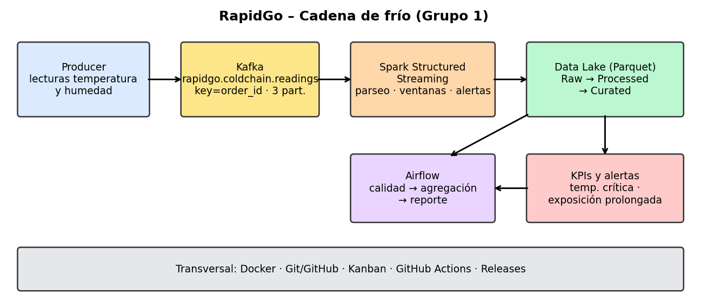

# RapidGo – Pipeline Big Data End-to-End: Cadena de frío

**Proyecto final de aula – Línea de Profundización I: Big Data**  
**Variante 3: Cadena de frío**  
**Release de Semana 1:** `v0.1.0-foundation` (preparación de la entrega)

---

## 1. Descripción del proyecto

RapidGo es una plataforma de entregas que necesita monitorear las condiciones de transporte de productos refrigerados y congelados. Durante el traslado, las variaciones de temperatura pueden afectar la calidad de los productos y generar pérdidas económicas.

Este proyecto propone una arquitectura Big Data para capturar lecturas de temperatura y humedad, transportarlas mediante Apache Kafka, procesarlas con Apache Spark Structured Streaming y almacenarlas en un Data Lake. Los indicadores y las alertas permitirán identificar posibles incumplimientos de las condiciones de la cadena de frío.

En esta primera semana se establece la arquitectura, el contrato de eventos, los indicadores iniciales, las reglas de alerta y la organización del repositorio. La implementación progresiva del pipeline se realizará en las siguientes semanas.

## 2. Objetivos

### Objetivo general

Diseñar e implementar progresivamente un pipeline Big Data para monitorear la cadena de frío de RapidGo mediante eventos de sensores, procesamiento distribuido, almacenamiento e indicadores operacionales.

### Objetivos específicos

- Definir un contrato JSON para las lecturas de temperatura y humedad.
- Utilizar Kafka para transportar eventos de monitoreo.
- Definir indicadores y reglas de alerta para detectar condiciones fuera de rango.
- Preparar el procesamiento mediante Spark Structured Streaming.
- Organizar el almacenamiento de datos en un Data Lake.
- Planificar la orquestación con Apache Airflow.
- Mantener trazabilidad del trabajo mediante GitHub, Issues, Kanban y releases.

## 3. Equipo de trabajo

| Integrante | Responsabilidades iniciales |
|---|---|
| Brayan Ramírez | Coordinación del repositorio, Docker Compose y documentación de ejecución. |
| Sebastián Bernal | Contrato JSON, eventos, KPIs y reglas de alerta. |
| Steban Blanco | Arquitectura, configuración de Kafka y documentación técnica. |

Las responsabilidades son una propuesta inicial y pueden ajustarse según los acuerdos del equipo. La participación se evidenciará mediante las Issues, los commits y los Pull Requests correspondientes.

## 4. Problema de negocio

Durante el transporte de productos refrigerados o congelados, es necesario mantener la temperatura dentro de rangos adecuados. Una temperatura excesiva o demasiado baja puede comprometer la conservación de la mercancía.

La solución permitirá registrar las lecturas de los sensores, detectar desviaciones, calcular indicadores por ventanas de tiempo y conservar los resultados para su consulta y análisis.

### Valor esperado

- Identificar condiciones anormales durante el transporte.
- Medir la frecuencia de las lecturas fuera de rango.
- Detectar exposiciones prolongadas a temperaturas inadecuadas.
- Proporcionar datos para mejorar el control operacional y la trazabilidad.

## 5. Arquitectura propuesta

La arquitectura de la variante Cadena de frío se organiza en las siguientes etapas:

1. **Producer:** genera eventos simulados de sensores asociados a pedidos y vehículos.
2. **Apache Kafka:** recibe y distribuye los eventos mediante el topic `rapidgo.coldchain.readings`.
3. **Apache Spark Structured Streaming:** consumirá los eventos, validará los datos, calculará indicadores y aplicará reglas de alerta.
4. **Data Lake:** almacenará los eventos y resultados en las capas Raw, Processed y Curated.
5. **Apache Airflow:** permitirá orquestar procesos de validación, agregación y generación de reportes.
6. **Indicadores y alertas:** mostrarán el comportamiento de las condiciones de la cadena de frío.

### Diagrama de arquitectura



La arquitectura descrita corresponde al diseño inicial. Los componentes de procesamiento, almacenamiento y orquestación se implementarán y validarán progresivamente durante las siguientes semanas.

## 6. Tecnologías propuestas

| Tecnología | Función |
|---|---|
| Python | Generación y transformación de eventos. |
| Apache Kafka | Transporte de eventos mediante un topic particionado. |
| Apache Spark Structured Streaming | Procesamiento de eventos en flujo. |
| Parquet | Formato previsto para almacenar datos procesados. |
| Data Lake | Organización de datos Raw, Processed y Curated. |
| Apache Airflow | Orquestación de tareas de procesamiento. |
| Docker Compose | Ejecución local de los servicios. |
| Git y GitHub | Control de versiones, colaboración e Issues. |
| GitHub Projects | Seguimiento del trabajo mediante Kanban. |
| GitHub Actions | Integración continua prevista a partir de la Semana 2. |

## 7. Contrato del evento

Los eventos representan lecturas de sensores relacionadas con un pedido y un vehículo. El esquema y el ejemplo inicial están disponibles en:

- Esquema: [`samples/evento_lectura.schema.json`](samples/evento_lectura.schema.json)
- Ejemplo: [`samples/evento_lectura_ejemplo.json`](samples/evento_lectura_ejemplo.json)

El contrato debe permitir identificar el evento, relacionarlo con el pedido y el vehículo, registrar la fecha y hora de la lectura, e incluir las mediciones de temperatura y humedad.

### Ejemplo ilustrativo

El siguiente ejemplo muestra la estructura conceptual del evento. El archivo de `samples/` es la referencia definitiva del contrato del proyecto.

```json
{
  "event_id": "evt-000001",
  "order_id": "PED-1001",
  "vehicle_id": "VEH-001",
  "timestamp": "2026-10-21T10:00:00Z",
  "temperature_c": 5.2,
  "humidity_pct": 65.0,
  "product_type": "refrigerado"
}
```

Los nombres y tipos definitivos de los campos deben coincidir con `evento_lectura.schema.json` y `evento_lectura_ejemplo.json`.

## 8. Kafka: topic, key y particiones

| Parámetro | Configuración inicial |
|---|---|
| Topic | `rapidgo.coldchain.readings` |
| Key | `order_id` |
| Número de particiones | 3 |
| Factor de replicación local | 1 |

### Justificación de la decisión

Se selecciona `order_id` como key para que las lecturas de un mismo pedido se asignen a una misma partición, conservando el orden dentro de ella.

Se proponen tres particiones para permitir procesamiento paralelo entre pedidos. El factor de replicación 1 se utiliza en el entorno local inicial y no proporciona tolerancia a la pérdida de un broker.

La decisión está documentada en [`docs/decisions/ADR-001-key-y-particiones-kafka.md`](docs/decisions/ADR-001-key-y-particiones-kafka.md).

### Evidencia inicial

Durante la preparación de la Semana 1:

- `docker compose config --quiet` terminó sin errores.
- `docker compose up -d` inició el servicio Kafka.
- El servicio de inicialización creó `rapidgo.coldchain.readings`.
- La consulta de descripción del topic confirmó tres particiones y factor de replicación 1.

Esta evidencia verifica la configuración inicial del topic; todavía no demuestra el comportamiento del productor ni el balance real de los eventos.

## 9. KPIs iniciales

Los siguientes indicadores se proponen para el monitoreo de la cadena de frío:

| KPI | Descripción | Unidad o ventana |
|---|---|---|
| Temperatura promedio | Promedio de temperatura de las lecturas recibidas. | °C por ventana de 5 minutos. |
| Lecturas fuera de rango | Cantidad y porcentaje de lecturas que incumplen el rango de temperatura definido para el producto. | Número y porcentaje por ventana. |
| Duración de exposición fuera de rango | Tiempo continuo durante el cual un pedido permanece fuera del rango permitido. | Minutos. |

Estos indicadores son definiciones iniciales. Su cálculo y validación se desarrollarán durante la implementación del pipeline.

## 10. Reglas de alerta iniciales

Los umbrales siguientes son valores iniciales de diseño y podrán ajustarse después de evaluar los datos simulados.

### Alerta 1: temperatura crítica

- Para productos refrigerados, se considera crítica una lectura inferior a `-1 °C` o superior a `11 °C`.
- Para productos congelados, se considera crítica una lectura superior a `-12 °C`.

Los rangos de referencia son de `2 °C` a `8 °C` para productos refrigerados y de `-25 °C` a `-15 °C` para productos congelados.

### Alerta 2: exposición prolongada

Se generará una alerta cuando la temperatura permanezca continuamente fuera del rango permitido durante `10 minutos`.

La evaluación debe considerar el tipo de producto y la secuencia temporal de las lecturas. Estas reglas están definidas como criterios iniciales; su implementación se realizará en las siguientes semanas.

## 11. Estructura del repositorio

```text
rapidgo-cadena-frio/
├── .github/
│   └── workflows/
├── airflow/
│   └── dags/
├── datalake/
│   └── README.md
├── docs/
│   ├── arquitectura.png
│   ├── checkpoints/
│   │   └── semana1.md
│   └── decisions/
│       └── ADR-001-key-y-particiones-kafka.md
├── producer/
├── samples/
│   ├── evento_lectura.schema.json
│   └── evento_lectura_ejemplo.json
├── spark/
├── tests/
├── .gitignore
├── docker-compose.yml
├── README.md
└── requirements.txt
```

La estructura contiene los espacios de trabajo previstos para los componentes del pipeline. Los archivos de implementación se incorporarán durante las siguientes semanas.

## 12. Requisitos previos

Para ejecutar la infraestructura local inicial se requiere:

- Git.
- Docker Desktop con Docker Compose.
- Conexión a Internet para descargar la imagen de Kafka la primera vez.

Python será necesario para las etapas de generación, procesamiento y pruebas del proyecto.

## 13. Ejecución local inicial

Desde la raíz del repositorio, ejecutar:

### Validar la configuración

```powershell
docker compose config --quiet
```

### Iniciar los servicios

```powershell
docker compose up -d
```

### Consultar el estado

```powershell
docker compose ps
```

### Consultar los logs de inicialización de Kafka

```powershell
docker compose logs kafka-init
```

### Verificar el topic

```powershell
docker exec coldchain-kafka /opt/kafka/bin/kafka-topics.sh --bootstrap-server localhost:9092 --describe --topic rapidgo.coldchain.readings
```

El entorno inicial valida la configuración de Docker y la creación del topic. La generación y el procesamiento de eventos se implementarán en las siguientes semanas.

Para detener los servicios:

```powershell
docker compose down
```

Este comando detiene y elimina los contenedores y la red del proyecto. No elimina automáticamente todos los archivos locales del repositorio.

## 14. Pruebas e integración continua

La carpeta `tests/` está preparada para incorporar pruebas del contrato JSON, validaciones de eventos y reglas de negocio.

La integración continua mediante GitHub Actions se desarrollará a partir de la Semana 2, incluyendo validación de sintaxis, ejecución de pruebas y validación de Docker Compose.

Por tanto, en esta entrega inicial no se afirma que las pruebas automatizadas o el workflow estén funcionando.

## 15. GitHub Project y planificación

El trabajo se organiza en el proyecto GitHub **RapidGo - Cadena de frío**, mediante un tablero Kanban con las columnas Backlog, Ready, In Progress, Review y Done.

El plan contiene al menos 12 Issues distribuidas entre las cuatro semanas:

- **Semana 1:** diseño, arquitectura, contrato, KPIs, alertas y organización.
- **Semana 2:** productor, Kafka, Spark Structured Streaming, almacenamiento y CI.
- **Semana 3:** orquestación con Airflow, calidad de datos y recuperación ante fallos.
- **Semana 4:** integración, validación final y publicación de la versión estable.

El tablero y las Issues permiten asignar responsables y mantener la trazabilidad del trabajo.

## 16. Documentación y entregas

| Entrega | Release esperada | Alcance |
|---|---|---|
| Semana 1 | `v0.1.0-foundation` | Diseño, arquitectura y organización. |
| Semana 2 | `v0.2.0-streaming` | Pipeline de eventos y procesamiento inicial. |
| Semana 3 | Según la guía del proyecto | Orquestación y controles de calidad. |
| Semana 4 | `v1.0.0` | Integración y validación final. |

Documentos principales:

- [Checkpoint de Semana 1](docs/checkpoints/semana1.md)
- [ADR-001: key y particiones de Kafka](docs/decisions/ADR-001-key-y-particiones-kafka.md)
- [Esquema JSON](samples/evento_lectura.schema.json)
- [Ejemplo de evento](samples/evento_lectura_ejemplo.json)
- [Diagrama de arquitectura](docs/arquitectura.png)

## 17. Contribuciones del equipo

| Integrante | Responsabilidades iniciales | Issues / PR |
|---|---|---|
| Brayan Ramírez | Coordinación del repositorio, Docker Compose y documentación de ejecución. | Registrar números reales de Issues y PR. |
| Sebastián Bernal | Contrato JSON, eventos, KPIs y reglas de alerta. | Registrar números reales de Issues y PR. |
| Steban Blanco | Arquitectura, Kafka y documentación técnica. | Registrar números reales de Issues y PR. |

Esta tabla debe actualizarse con las asignaciones y contribuciones reales del equipo a medida que avance el proyecto.

## 18. Limitaciones actuales y trabajo futuro

En la entrega de Semana 1 se ha preparado la base documental y la infraestructura local inicial de Kafka. Todavía no se considera implementado el pipeline completo.

El trabajo futuro contempla:

- Implementar el productor de lecturas.
- Consumir y transformar eventos con Spark Structured Streaming.
- Calcular los KPIs y generar las alertas.
- Persistir resultados en Parquet y configurar checkpoints.
- Incorporar pruebas automatizadas y GitHub Actions.
- Implementar la orquestación con Airflow.
- Validar el comportamiento integral del pipeline y documentar los resultados.

---

**Repositorio:** https://github.com/luiguicrack/rapidgo-cadena-frio

**Variante:** 3 – Cadena de frío

**Release de Semana 1 prevista:** `v0.1.0-foundation`
