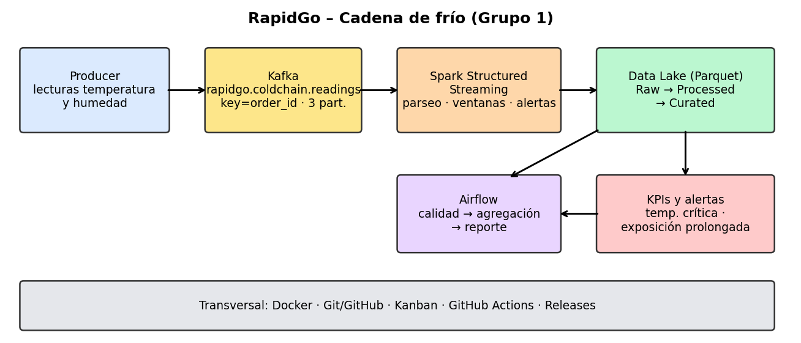

# RapidGo – Pipeline Big Data End-to-End: Cadena de Frío

**Proyecto final de aula – Línea de Profundización I: Big Data**  
**Variante 3: Cadena de frío**  
**Versión final:** `v1.0.0`

---

## 1. Descripción del proyecto

RapidGo es un proyecto académico que implementa un pipeline Big Data para monitorear las condiciones de temperatura y humedad durante el transporte de productos refrigerados y congelados.

La solución simula la generación de lecturas de sensores y las transporta mediante Apache Kafka. Posteriormente, Apache Spark Structured Streaming procesa los eventos y genera resultados almacenados en un Data Lake en formato Parquet. Finalmente, Apache Airflow incorpora una capa de orquestación y validación sobre los componentes principales del pipeline.

El proyecto integra los componentes desarrollados durante las diferentes semanas de trabajo y documenta las decisiones técnicas, pruebas, evidencias y resultados obtenidos.

---

## 2. Equipo de trabajo

| Integrante | Rol y responsabilidades principales |
|---|---|
| **Brayan Ramírez** | Coordinación del repositorio, productor de eventos, Docker Compose, documentación de ejecución y orquestación con Airflow. |
| **Sebastián Bernal** | Contrato de eventos, validaciones, indicadores y reglas de alerta. |
| **Steban Blanco** | Arquitectura, configuración de Kafka, procesamiento y documentación técnica. |

La trazabilidad del trabajo se encuentra en las Issues, Pull Requests, commits y documentación del repositorio.

---

## 3. Problema de negocio

Durante el transporte de productos refrigerados y congelados es necesario mantener las condiciones ambientales dentro de rangos adecuados.

Una variación prolongada o crítica de la temperatura puede afectar la calidad de los productos, generar pérdidas económicas y comprometer la operación logística.

RapidGo necesita una solución que permita:

- Registrar continuamente lecturas de temperatura y humedad.
- Transportar los eventos de manera desacoplada.
- Detectar temperaturas fuera de rango.
- Generar alertas sobre condiciones críticas.
- Calcular indicadores para el monitoreo de los vehículos.
- Almacenar los resultados para futuras consultas y análisis.

### Valor de la solución

La arquitectura implementada permite:

- Mejorar la trazabilidad de las lecturas durante el transporte.
- Detectar condiciones anormales en la cadena de frío.
- Separar los datos según su nivel de procesamiento.
- Mantener resultados en formato Parquet para análisis posterior.
- Automatizar la validación de componentes mediante Airflow.
- Mantener controles de calidad mediante pruebas automatizadas e integración continua.

---

## 4. Arquitectura del proyecto

El pipeline de RapidGo está organizado en las siguientes etapas:

1. **Producer:** genera eventos simulados de temperatura y humedad.
2. **Apache Kafka:** recibe y distribuye los eventos mediante un topic particionado.
3. **Apache Spark Structured Streaming:** consume los eventos, los valida, clasifica y procesa.
4. **Data Lake:** almacena los resultados en las capas Raw, Processed y Curated.
5. **Apache Airflow:** ejecuta tareas de validación sobre Kafka y los resultados disponibles en el Data Lake.
6. **GitHub Actions:** ejecuta las pruebas automatizadas como parte de la integración continua.

### Diagrama de arquitectura



### Flujo general

```text
┌──────────────┐
│   Producer   │
│    Python    │
└──────┬───────┘
       │ Eventos JSON
       ▼
┌──────────────┐
│ Apache Kafka │
│    Topic     │
└──────┬───────┘
       │ Streaming
       ▼
┌───────────────────────────┐
│ Apache Spark Structured   │
│        Streaming          │
└──────┬────────────────────┘
       │
       ├────────► Raw
       ├────────► Processed
       ├────────► Rejected
       ├────────► Alerts
       └────────► KPIs
                    │
                    ▼
              ┌───────────┐
              │ Data Lake │
              │  Parquet  │
              └─────┬─────┘
                    │
                    ▼
              ┌───────────┐
              │  Airflow  │
              │Validación │
              └───────────┘
```

---

## 5. Tecnologías utilizadas

| Tecnología | Rol en el proyecto |
|---|---|
| **Python** | Generación de eventos, productor Kafka, validaciones y pruebas. |
| **Apache Kafka** | Transporte y distribución de eventos en tiempo real. |
| **Apache Spark Structured Streaming** | Procesamiento continuo de los eventos recibidos desde Kafka. |
| **Parquet** | Formato de almacenamiento para las salidas del Data Lake. |
| **Data Lake** | Organización de datos en zonas Raw, Processed y Curated. |
| **Apache Airflow** | Orquestación y validación de la disponibilidad de Kafka y del Data Lake. |
| **Docker Compose** | Ejecución local de Kafka, Spark y Airflow. |
| **JSON Schema** | Validación de la estructura de los eventos. |
| **Pytest** | Ejecución de pruebas automatizadas. |
| **GitHub Actions** | Integración continua y ejecución automática de pruebas. |
| **Git y GitHub** | Control de versiones, colaboración y trazabilidad del proyecto. |

---

## 6. Estructura del repositorio

```text
rapidgo-cadena-frio/
├── .github/
│   └── workflows/
│       └── ci.yml
├── airflow/
│   └── dags/
│       └── rapidgo_orquestacion.py
├── datalake/
│   ├── raw/
│   ├── processed/
│   ├── curated/
│   └── checkpoints/
├── docs/
│   ├── arquitectura.png
│   ├── checkpoints/
│   │   ├── semana1.md
│   │   ├── semana2.md
│   │   ├── semana3.md
│   │   └── semana4.md
│   ├── decisions/
│   │   ├── ADR-001-key-y-particiones-kafka.md
│   │   ├── ADR-002-checkpoints-y-zonas-datalake.md
│   │   ├── ADR-003-orquestacion-y-validacion-del-pipeline.md
│   │   └── ADR-004-validacion-integracion.md
│   ├── evidencias/
│   ├── operacion-calidad-recuperacion.md
│   └── pruebas-y-ci.md
├── producer/
│   ├── __init__.py
│   ├── generador.py
│   └── producer.py
├── samples/
│   ├── evento_lectura.schema.json
│   └── evento_lectura_ejemplo.json
├── spark/
│   ├── __init__.py
│   ├── alert_rules.py
│   ├── streaming.py
│   └── verificar_salida.py
├── tests/
│   ├── test_contrato.py
│   ├── test_generador.py
│   └── test_reglas_alerta.py
├── docker-compose.yml
├── pytest.ini
├── requirements.txt
└── README.md
```

---

# 7. Prerrequisitos

Para ejecutar el proyecto localmente se requiere:

- Python 3.13 o una versión compatible.
- Docker Desktop con Docker Compose.
- Git.
- Conexión a Internet para descargar las imágenes de Docker y las dependencias necesarias.

---

## 8. Instalación del proyecto

Clonar el repositorio:

```bash
git clone https://github.com/luiguicrack/rapidgo-cadena-frio.git
cd rapidgo-cadena-frio
```

Crear un entorno virtual.

### Windows PowerShell

```powershell
python -m venv .venv
.\.venv\Scripts\Activate.ps1
```

Instalar las dependencias:

```powershell
python -m pip install -r requirements.txt
```

---

# 9. Ejecución local

## 9.1 Validar Docker Compose

Desde la raíz del repositorio:

```powershell
docker compose config --quiet
```

Si el comando finaliza sin mostrar errores, la configuración de Docker Compose es válida.

---

## 9.2 Iniciar los servicios

Ejecutar:

```powershell
docker compose up -d
```

Este comando inicia los servicios configurados para:

- Apache Kafka.
- Inicialización del topic.
- Apache Spark Structured Streaming.
- Apache Airflow.

Consultar el estado:

```powershell
docker compose ps
```

---

## 9.3 Verificar el topic de Kafka

El proyecto utiliza el siguiente topic:

```text
rapidgo.coldchain.readings
```

Consultar la configuración del topic:

```powershell
docker exec coldchain-kafka /opt/kafka/bin/kafka-topics.sh --bootstrap-server localhost:9092 --describe --topic rapidgo.coldchain.readings
```

La configuración inicial utiliza:

| Parámetro | Valor |
|---|---|
| Topic | `rapidgo.coldchain.readings` |
| Key | `order_id` |
| Particiones | 3 |
| Factor de replicación local | 1 |

El uso de `order_id` como clave permite que los eventos asociados al mismo pedido sean enviados a la misma partición, conservando su orden dentro de ella.

---

# 10. Eventos y contrato

Los eventos representan lecturas de sensores relacionadas con un pedido y un vehículo.

El contrato se encuentra en:

```text
samples/evento_lectura.schema.json
```

Los principales campos del evento son:

- `event_id`
- `team_id`
- `order_id`
- `vehicle_id`
- `product_type`
- `temperature_c`
- `humidity_pct`
- `event_ts`

Ejemplo conceptual:

```json
{
  "event_id": "evt-000001",
  "team_id": "grupo-1-cadena-frio",
  "order_id": "PED-1001",
  "vehicle_id": "VEH-001",
  "product_type": "refrigerado",
  "temperature_c": 5.2,
  "humidity_pct": 65.0,
  "event_ts": "2026-10-21T10:00:00Z"
}
```

El contrato JSON y el ejemplo disponible en `samples/` constituyen la referencia para la estructura de los eventos.

---

# 11. Ejecutar el productor

Para realizar una simulación sin enviar eventos a Kafka:

```powershell
python -m producer.producer --dry-run --max-eventos 5
```

Para publicar eventos en Kafka:

```powershell
python -m producer.producer --max-eventos 10
```

El productor utiliza la configuración del proyecto para conectarse a Kafka y publicar eventos en:

```text
rapidgo.coldchain.readings
```

---

# 12. Procesamiento con Spark Structured Streaming

Spark Structured Streaming consume los eventos desde Kafka y genera diferentes salidas en el Data Lake.

Las principales zonas utilizadas son:

| Zona | Ruta | Contenido |
|---|---|---|
| Raw | `datalake/raw/events` | Eventos recibidos desde Kafka. |
| Processed | `datalake/processed/readings` | Lecturas procesadas y validadas. |
| Rejected | `datalake/processed/rejected` | Registros que no cumplen las validaciones. |
| Curated - Alerts | `datalake/curated/alerts` | Alertas generadas durante el procesamiento. |
| Curated - KPIs | `datalake/curated/kpis` | Indicadores agregados del pipeline. |
| Checkpoints | `datalake/checkpoints/spark` | Estado de las consultas de Spark Structured Streaming. |

Los resultados se almacenan en formato Parquet.

---

# 13. KPIs principales

El pipeline contempla indicadores para el monitoreo de la cadena de frío.

Entre los principales se encuentra:

### Temperatura promedio por vehículo

Se calcula el promedio de temperatura de las lecturas procesadas por vehículo mediante ventanas de tiempo de cinco minutos.

Los resultados permiten observar el comportamiento general de la temperatura durante el transporte.

---

# 14. Reglas de alerta

Las reglas principales consideran el tipo de producto y la temperatura registrada.

### Productos refrigerados

Rango de referencia:

```text
2 °C a 8 °C
```

Una lectura crítica se considera cuando la temperatura es:

```text
Menor a -1 °C o mayor a 11 °C
```

### Productos congelados

Rango de referencia:

```text
-25 °C a -15 °C
```

Una lectura crítica se considera cuando la temperatura es:

```text
Mayor a -12 °C
```

El procesamiento también clasifica las lecturas según su estado, incluyendo condiciones normales, fuera de rango y críticas.

---

# 15. Ejecutar las pruebas automatizadas

Desde la raíz del repositorio ejecutar:

```powershell
python -m pytest -v
```

Las pruebas cubren, entre otros aspectos:

- Validación del contrato JSON.
- Generación de eventos.
- Validación de campos y valores.
- Reglas de alerta.
- Lecturas normales y fuera de rango.
- Evaluación según el tipo de producto.
- Ordenamiento y procesamiento de lecturas.

Como evidencia documentada del proyecto, una ejecución de pruebas finalizó con:

```text
51 passed
```

---

# 16. Integración continua con GitHub Actions

El workflow de integración continua se encuentra en:

```text
.github/workflows/ci.yml
```

El flujo se ejecuta mediante:

- `push` hacia la rama `main`.
- Pull Requests hacia `main`.
- Ejecución manual mediante `workflow_dispatch`.

El workflow realiza las siguientes actividades:

1. Descarga el repositorio.
2. Configura Python 3.13.
3. Instala las dependencias.
4. Ejecuta las pruebas automatizadas con Pytest.

La documentación adicional se encuentra en:

```text
docs/pruebas-y-ci.md
```

Para verificar la CI, después de realizar un Push o crear un Pull Request se debe consultar la pestaña **Actions** del repositorio en GitHub.

---

# 17. Acceso y ejecución de Apache Airflow

Apache Airflow se inicia como parte de Docker Compose.

Después de ejecutar:

```powershell
docker compose up -d
```

la interfaz web está disponible en:

```text
http://localhost:8080
```

El servicio utiliza el modo `standalone`.

El DAG implementado se denomina:

```text
rapidgo_orquestacion
```

El archivo correspondiente es:

```text
airflow/dags/rapidgo_orquestacion.py
```

## Tareas del DAG

El DAG contiene dos tareas principales:

### `verificar_kafka`

Comprueba que Kafka acepte conexiones desde Airflow utilizando:

```text
Host: kafka
Puerto: 9092
```

### `verificar_datalake`

Comprueba que existan datos Parquet en las siguientes rutas:

```text
RAW: /opt/rapidgo/datalake/raw/events
PROCESSED: /opt/rapidgo/datalake/processed/readings
```

Las tareas se ejecutan en el siguiente orden:

```text
verificar_kafka >> verificar_datalake
```

## Ejecutar el DAG

1. Abrir la interfaz de Airflow en `http://localhost:8080`.
2. Iniciar sesión con las credenciales generadas por Airflow Standalone.
3. Localizar el DAG `rapidgo_orquestacion`.
4. Activarlo si se encuentra pausado.
5. Ejecutarlo manualmente.
6. Consultar el estado y los logs de las tareas.

También es posible consultar los DAG disponibles desde la terminal:

```powershell
docker compose exec airflow airflow dags list
```

Consultar las ejecuciones:

```powershell
docker compose exec airflow airflow dags list-runs -d rapidgo_orquestacion
```

---

# 18. Resultados y evidencias representativas

Durante el desarrollo y validación del proyecto se obtuvieron evidencias de los principales componentes:

- Kafka iniciado mediante Docker Compose.
- Topic `rapidgo.coldchain.readings` creado con tres particiones.
- Eventos generados y publicados mediante el productor.
- Validación del contrato JSON.
- Ejecución de pruebas automatizadas con **51 pruebas aprobadas** en la evidencia documentada.
- Resultados del procesamiento almacenados en el Data Lake en formato Parquet.
- Existencia de salidas para datos Raw, Processed, Rejected, Alerts y KPIs.
- DAG `rapidgo_orquestacion` visible en Apache Airflow.
- Ejecución satisfactoria documentada del DAG de orquestación.
- Ejecuciones de integración continua mediante GitHub Actions.

Las capturas y evidencias del proyecto se encuentran en:

```text
docs/evidencias/
```

Los checkpoints de cada etapa se encuentran en:

```text
docs/checkpoints/
```

---

# 19. Decisiones técnicas

Las principales decisiones técnicas se documentaron mediante Architectural Decision Records (ADR).

Entre ellas se encuentran:

- **ADR-001:** uso de `order_id` como clave de Kafka y configuración de las particiones.
- **ADR-002:** separación de las zonas del Data Lake y uso de checkpoints para las consultas de Spark.
- **ADR-003:** incorporación de Apache Airflow para la orquestación y validación del pipeline.
- **ADR-004:** validación de la integración entre los componentes disponibles del proyecto.

Los documentos completos se encuentran en:

```text
docs/decisions/
```

---

# 20. Limitaciones conocidas y trabajo futuro

Aunque el proyecto integra los principales componentes de la arquitectura propuesta, existen aspectos que pueden ampliarse en futuras versiones.

Entre ellos:

- Implementar una arquitectura de Kafka con múltiples brokers y mayor tolerancia a fallos.
- Ampliar las pruebas de integración de extremo a extremo.
- Incorporar métricas adicionales para el monitoreo del pipeline.
- Mejorar la detección de exposiciones prolongadas mediante una validación temporal más completa.
- Incorporar mecanismos adicionales de calidad y observabilidad.
- Implementar almacenamiento y configuración orientados a un entorno productivo.
- Ampliar la orquestación de Airflow para ejecutar procesos adicionales del pipeline.

Estas mejoras permitirían evolucionar el proyecto desde un entorno académico y local hacia una arquitectura con mayores capacidades operativas.

---

# 21. Contribuciones del equipo

| Integrante | Responsabilidades principales | Issues y PR principales |
|---|---|---|
| **Brayan Ramírez** | Coordinación del repositorio, productor de eventos, Docker Compose, documentación de ejecución y DAG de Airflow. | Issue **#7** – Implementación del productor. PR **#13** – `feat: producer de lecturas de cadena de frío`. Trabajo de orquestación documentado en la Semana 3. |
| **Sebastián Bernal** | Contrato JSON, validaciones de eventos, KPIs y reglas de alerta. | Contribuciones trazables mediante las Issues, commits y Pull Requests asociados al contrato y procesamiento del proyecto. |
| **Steban Blanco** | Arquitectura, configuración de Kafka, procesamiento del pipeline y documentación técnica. | Contribuciones trazables mediante las Issues, commits y Pull Requests asociados a la arquitectura y al procesamiento del proyecto. |

La información completa sobre la participación del equipo se encuentra en el historial del repositorio, las Issues y los Pull Requests realizados durante el desarrollo.

---

# 22. Documentación por semanas

El proyecto cuenta con checkpoints que registran el avance realizado durante las cuatro semanas:

| Semana | Documento | Alcance principal |
|---|---|---|
| Semana 1 | `docs/checkpoints/semana1.md` | Diseño, arquitectura, contrato y organización inicial. |
| Semana 2 | `docs/checkpoints/semana2.md` | Productor, Kafka, Spark y Data Lake. |
| Semana 3 | `docs/checkpoints/semana3.md` | Orquestación, Airflow y recuperación ante fallos. |
| Semana 4 | `docs/checkpoints/semana4.md` | Validación final, pruebas y evidencias. |

---

# 23. Video final de demostración

En el siguiente video se presenta una explicación general del proyecto, la arquitectura implementada, los componentes del repositorio y el funcionamiento del pipeline:

**Enlace al video:** **[AGREGAR AQUÍ EL ENLACE DEL VIDEO FINAL]**

El video puede incluir:

- Presentación del problema de negocio.
- Explicación de la arquitectura.
- Recorrido por la estructura del repositorio.
- Generación y envío de eventos.
- Funcionamiento de Kafka.
- Procesamiento y resultados del Data Lake.
- Ejecución del DAG de Airflow.
- Pruebas automatizadas y GitHub Actions.
- Resultados y conclusiones del proyecto.

---

# 24. Detener los servicios

Cuando finalices las pruebas, puedes detener los servicios con:

```powershell
docker compose down
```

Este comando detiene y elimina los contenedores creados por Docker Compose.

No elimina el código fuente ni la documentación del proyecto.

---

## Versión final

**Proyecto:** RapidGo – Cadena de Frío  
**Variante:** 3 – Cadena de frío  
**Versión:** `v1.0.0`  
**Estado:** Entrega final
